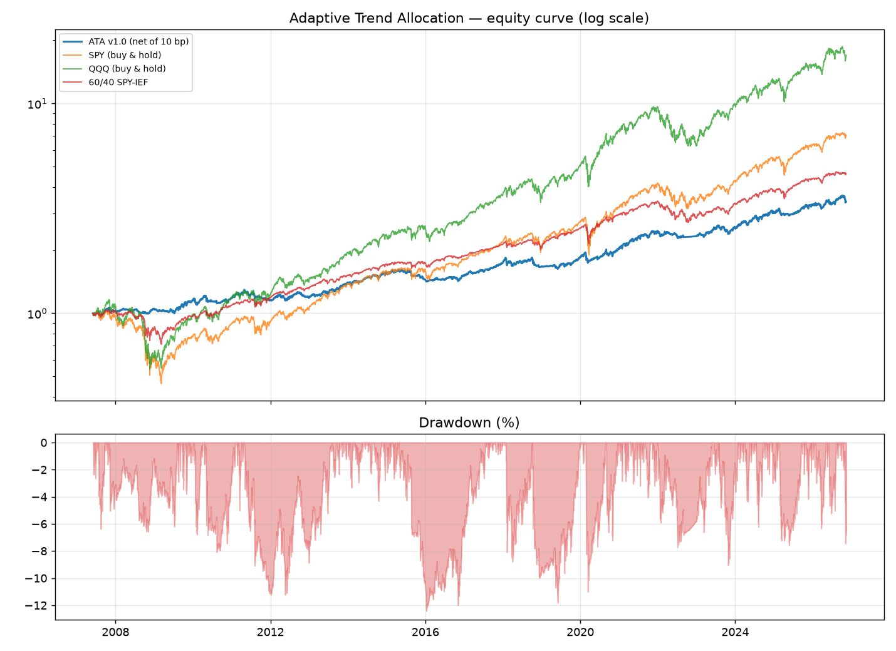

# Adaptive Trend Allocation (ATA) — AI4Finance Open Trading Challenge

Submission for the [AI4Finance Open Trading Challenge](https://ai4finance.org/competition)
(Pilot Quarter · framework **FinRL-X / FinRL-Trading** · broker **Alpaca Paper**).

A defensive, fully automated, long-only multi-asset **time-series momentum**
strategy that trades a paper account every session through GitHub Actions and
publishes its own audit trail.

| | |
|---|---|
| **Strategy** | Trend-gated core (SPY/QQQ) + inverse-volatility satellite book (GLD/IEF/TLT/DBC) + 12% volatility target, cash in T-bills |
| **Backtest (2007–2026, net)** | Sharpe **0.55** · Sortino **0.67** · max drawdown **−12.4%** · Calmar 0.52 (SPY: 0.51 / 0.62 / −55.2%) |
| **Live** | Alpaca **paper** account, market orders at 09:45 New York, zero manual intervention |
| **Audit trail** | [`logs/decisions.csv`](logs/) · [`logs/trades.csv`](logs/) · [`results/daily_equity.csv`](results/) |
| **Daily report** | [`results/live_summary.md`](results/) + [`figs/live_equity.png`](figs/) — rebuilt automatically every session by `daily-report` |
| **Docs** | [STRATEGY.md](STRATEGY.md) (research record) · [RUNBOOK.md](RUNBOOK.md) (setup + operations) · [SUBMISSION.md](SUBMISSION.md) (how to submit) · [docs/CODE_GUIDE.md](docs/CODE_GUIDE.md) (**non-programmer's tour of the code**) |

> Every source file opens with a plain-English explanation of what it does, why
> it exists, and what it deliberately refuses to do. Reviewers who do not code
> can read those headers alone and understand the whole system — start with
> [docs/CODE_GUIDE.md](docs/CODE_GUIDE.md).

---

## How the framework is used

The strategy is a first-class FinRL-X strategy: it implements
`BaseStrategy.generate_weights()` and returns the weight vector that the paper
introduced as the single contract between research and execution.

```
data (Yahoo, cached)  →  AdaptiveTrendAllocationStrategy.compute()  →  {symbol: weight}
                                     │                                        │
                    scripts/backtest.py (net-of-cost P&L)      AlpacaManager.execute_portfolio_rebalance()
                                                                      (FinRL-X execution layer)
```

Nothing is re-implemented that the framework already provides: order placement,
position sizing, fractional-share handling, market-clock checks and paper-mode
guards all come from `src/trading/alpaca_manager.py`. The only additions are the
strategy, the daily runner, the research tooling and the tests.

### Mapping to the paper's pipeline

| FinRL-X stage | Implementation |
|---|---|
| **S** — selection | `_gate()`: 200d SMA + 126d momentum per asset |
| **A** — allocation | core budget 70% + inverse-vol satellite budget 30% |
| **T** — timing | closed gates move their budget to T-bills (BIL) |
| **R** — risk overlay | 12% vol target with hysteresis, 45% per-name cap, 2% cash floor |

### Why not just run the framework's own Adaptive Rotation?

Because I ran it. Same engine, same window (2018-01 → 2026-10), only the universe
changed: its **shipped** universe (hand-picked mega caps: NVDA, META, TSLA, …)
scores Sharpe **1.17**, an **unbiased** sector-ETF universe scores **0.74**, and
this strategy scores **0.70** with a smaller drawdown (−11.8% vs −23.3% / −15.0%).
The headline edge is mostly universe selection made with hindsight, which is not
deployable. Full table and method: [STRATEGY.md §2.1](STRATEGY.md).

## Repository layout

```
src/strategies/adaptive_trend.py   the strategy (config, indicators, weights, metadata)
src/trading/alpaca_manager.py      FinRL-X execution layer (unmodified, Apache-2.0)
scripts/data.py                    cached Yahoo Finance loader (+ refresh for live)
scripts/backtest.py                net-of-cost backtest, metrics, sweep, plot
scripts/run_daily.py               the live job: signal → compare → rebalance → log
scripts/report.py                  live equity curve + Sharpe/Sortino/max-DD report
tests/test_adaptive_trend.py       18 unit tests (synthetic data, no network)
.github/workflows/live.yml         the schedule that trades the account
.github/workflows/report.yml       the schedule that rebuilds the daily report
.github/workflows/ci.yml           tests on every push
```

## Quick start

```bash
git clone <your-fork-url> && cd finrl-gfc-sxtym
pip install -r requirements-live.txt

python -m pytest -q tests                    # 18 automatic checks, ~2 s, no network
python -m scripts.backtest --save --plot     # full-sample results + equity plot
python -m scripts.run_daily --signal-only    # today's target vector (no keys needed)
```

Paper trading (needs Alpaca paper keys in `.env` — see [RUNBOOK.md](RUNBOOK.md)):

```bash
cp .env.example .env      # paste APCA_API_KEY / APCA_API_SECRET
python -m scripts.run_daily --dry-run     # preview the order plan
python -m scripts.run_daily               # place paper orders
python -m scripts.run_daily --snapshot    # record end-of-day equity
python -m scripts.report                  # live metrics + equity curve
```

## Configuration

All parameters live in `ATAConfig` (one dataclass, no hidden state):

| Parameter | Default | Meaning |
|---|---|---|
| `core` | SPY 0.45, QQQ 0.25 | equity beta legs and their budgets |
| `satellites` | GLD, IEF, TLT, DBC | diversifier sleeve, inverse-vol weighted |
| `satellite_total` | 0.30 | sleeve budget |
| `trend_window` | 200 | SMA length for the absolute-momentum gate |
| `mom_window` | 126 | momentum lookback (6 months) |
| `target_vol` | 0.12 | annualised portfolio volatility target (never levered) |
| `vol_band` | 0.10 | scaler hysteresis → turnover control |
| `max_weight` | 0.45 | per-ETF cap |
| `min_cash` | 0.02 | permanent cash buffer |

Runtime knobs are environment variables (`DRIFT_BAND`, `MIN_ORDER_NOTIONAL`,
`LIVE_START`) — see `.env.example`.

## Risk controls

* long only, no leverage, no shorting, no derivatives, no intraday trading;
* hard refusal to trade if `APCA_BASE_URL` is not a paper endpoint
  (`scripts/run_daily.py::alpaca`);
* volatility target capped at 100% invested;
* per-name cap and a 2% cash floor;
* 2% no-trade band to suppress churn (turnover ≈ 3.6% of the book per session);
* every decision logged with the gate states that produced it, so any trade can
  be explained after the fact.

## Results



Full tables, sub-periods, calendar years and the robustness grid:
`python -m scripts.backtest --save --plot` → `results/backtest_metrics.json`.
Live results: `python -m scripts.report` → `results/live_summary.md`.

## Credits & licence

* Framework: **FinRL-X / FinRL-Trading** © AI4Finance Foundation, Apache-2.0 —
  see [LICENSE](LICENSE) and the upstream README (`README_FinRL-X.md`).
* Strategy, runner, research tooling and tests: original work submitted to the
  AI4Finance Open Trading Challenge.

> Research and educational code. Paper trading only. Not investment advice.
